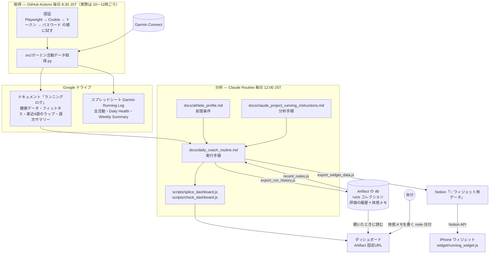

# システム構成

Garmin のデータを毎朝 Google ドライブへ取り込み、毎日 12:00 JST に Claude Routine が分析して
ダッシュボードとウィジェットへ出す。取得（GitHub Actions）と分析（Routine）を分けているのは、
Routine の実行環境から Garmin へ接続できないため（egress プロキシが `*.garmin.com` を拒否する）。

## 全体像

## 何がどこの「正」か

同じ値を2か所に持たない。持つと前提が分裂する。

| もの | 正 | 備考 |
|------|----|------|
| 目標レース・目標タイム・ペースゾーン・ロードマップ | `docs/athlete_profile.md` | ダッシュボードのシーズンの帯とペース帯（ラップの色分け・心拍上限の線・ステディ帯）は `scripts/profile_season.js` がこの表を読んで差し込む |
| 月間計画・段階（A−〜C）・判定の機会・積み上げの目標 | `docs/athlete_profile.md` | 同じく `profile_season.js` が表を読む（ホームの月間目標・走力の階段・ロングと積み上げの目標。2026-10-26〜） |
| 本人の体感（脚の張り・きつさ・痛み・補強・メモ） | Artifact の db（`runs` の doc_id `note-YYYY-MM-DD`・`kind: "note"`） | ダッシュボードのホームで本人が書く。Routine は STEP 3.5 で読むだけ。`runs` に同居させているのは、Routine が承認なしで読めるのが `runs` だけだから |
| ダッシュボードの描画（HTML / CSS / 描画スクリプト） | リポジトリの `dashboard/index.html`（main） | Routine は毎日これを土台に DATA だけ差し替えて公開する |
| その日の分析（DATA） | 公開済みの Artifact | 毎日の DATA はコミットしない。リポジトリの DATA は古いスナップショット |
| 過去の評価（カレンダー・推移） | Artifact の db（`runs`） | 1日1件。2026-09-02 より前の距離は `BASE_KM`（`scripts/export_base_km.py`） |
| ウィジェットの表示内容 | Notion のウィジェット用ページの JSON | Routine が `scripts/export_widget_data.js` の出力で丸ごと置き換える |
| Garmin の生データ | Google ドライブのドキュメントとスプレッドシート | GitHub Actions が毎朝上書きする |

## 取得の時刻

ワークフローの予約は 23:30 UTC（8:30 JST）だが、GitHub の予約実行は混雑で遅れ、2026-10 は毎日 10:15〜11:00 JST ごろに走っている。
12:00 の Routine には間に合っているが、12:00 を過ぎるとその日の分析は前日のデータで行われる（ダッシュボードに「データが最新ではありません」）。

## 活動の重複（2026-10-26 に修正）

Playwright の事前取得（`scripts/refresh_garmin_cookies_playwright.py`）は、ページネーション用に自分で呼んだ `fetch` のレスポンスも
`page.on("response")` で拾っていた。そのため同じ50件が2回入り、次のページの開始位置も倍に進んで、その先の50件が抜けていた
（ドキュメントの週次サマリーで 8〜10月の週が実際の約2倍）。いまは activityId で重複を落とし、本体（`dedupe_activities`）でも落とす。

## 認証まわり

Garmin はプログラムからのログインを頻繁に制限する（429）。取得ジョブは先に Playwright のヘッドレスブラウザで
実際にログインし、セッション Cookie と活動データを取っておく（`scripts/refresh_garmin_cookies_playwright.py`。
失敗してもジョブは続く）。そのうえで本体は次の順に試す。

### Playwright のログイン（本線）

Connect のウェブのセッション（`JWT_WEB`）を作れれば、データはブラウザ経由で取れる（OAuth は要らない）。順に試す。

1. 新しいサインイン画面（`sso.garmin.com/portal/...`）にフォーム入力する。
   Cloudflare の人間確認（「Just a moment...」）が出てフォームが出なければ、あきらめて次へ（突破はしない）。
2. 旧 SSO（`/sso/signin`）にパスワードでログインする。`/app` 向けが断られたら embed 向け（garth と同じ）で入り直す。
   パスワードを送るのは最大2回（何度も送るとログイン制限が厳しくなる）。
3. ログインでできた SSO セッション（`CASTGC`）を使って、Connect 用のチケットを出させる（CAS の普通の仕組み。パスワードは送らない）。
   Garmin は Connect のサービス URL を何度か変えている（2026-05 は `/modern`、その後 `/app`）ので、
   `/app`・`/modern/`・`/modern` と `/sso/login`・`/sso/signin` の組み合わせを順に試す。
4. チケットをブラウザで開いて `JWT_WEB` を受け取る。チケットが取れなくても、SSO のクッキーをドメインとパスのまま
   ブラウザに渡し、ブラウザ側で CAS のログイン URL → `/app/home` を開く。新しいサインイン画面に着いてフォームが出ていれば入力する。

どの経路がどう断られたか（ステータス・ページのタイトル・リダイレクト先）を Actions のログに出す。
次に Garmin が変わったときは、まずこのログで、どの経路が生きているかを見る。

経緯: 2026-05 は 2 だけで通っていた（`/modern`→`/app`）。2026-10-28 から 2 の `/app` 向けが 403、
1 は人間確認で止まるようになった。embed 向けのログインは通り続けていたので、3 を足した。

### 本体の認証

1. Playwright が先に取っておいた活動データ（OAuth 不要。健康データは 2 以降のクライアントで補う）
2. セッション Cookie（Playwright が保存したもの、無ければ `GARMIN_SESSION_COOKIES`）
3. `~/.garth` のトークン（Actions のキャッシュに前回分が残る）
4. `GARTH_TOKENS_B64`（OAuth トークン）
5. メールアドレスとパスワード（GitHub Actions では1回だけ。3〜5 は 2026-04 以降 Actions からはほぼ毎回 429 で、
   再試行はログイン回数を増やすだけなので）

成功したトークンは `GH_PAT_SECRETS` が設定されていれば `GARTH_TOKENS_B64` に書き戻す。
すべて失敗したときは、手元の Mac で `scripts/generate_garth_token_browser.py` などを使ってトークンを取り直す
（手順は各スクリプトの冒頭）。

## Notion について

名前に残っているとおり、もとは Garmin の記録を Notion のデータベースへ同期するプロジェクトだった。
Notion への記録は 2026-09-11 に廃止した（無人の Routine が承認待ちで止まるため）。
いま Notion を使うのは、ウィジェット用ページの全文置換1か所だけ（`.claude/settings.json` のフックで、そのページ以外への書き込みは拒否される）。

## NotebookLM / Gemini で使う場合（任意）

ドライブのドキュメントとスプレッドシートは、NotebookLM のソースや Gemini の知識として読ませることもできる。
手順は [`SETUP_GUIDE.md`](SETUP_GUIDE.md) の最後。
